<div align="center">

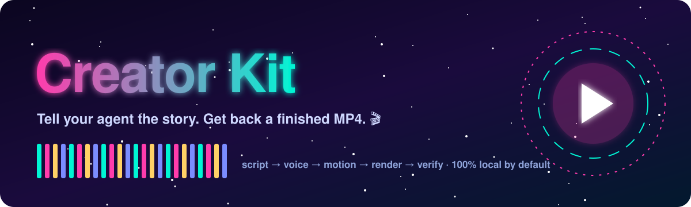

<a href="#-quick-start"></a>

<br/>


**Describe it to your coding agent. Get back a narrated, animated, verified MP4.**
<br/>Claude Code · GitHub Copilot CLI · Codex · Hermes — any agent that can read Markdown.

</div>

---

## 🎬 The machine

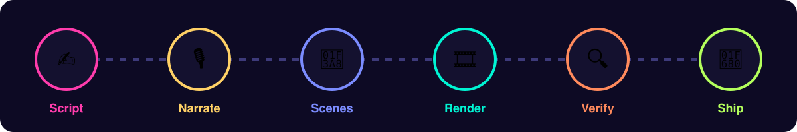

Your agent writes the script, voices it, builds the scenes, renders a frame-exact MP4 and then
**checks its own work** (ffprobe, sampled frames, listening to the audio) before calling it done.

---

## 👉 Narrated walkthroughs — arrows, spotlight, cursor, captions

<div align="center">
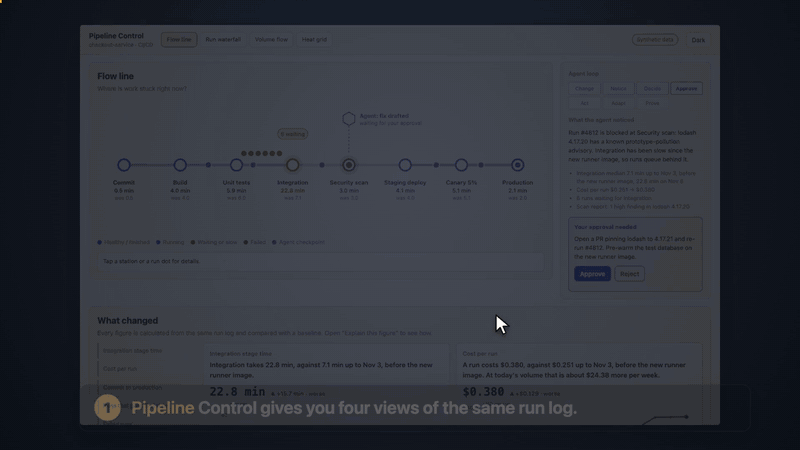
</div>

Give it screenshots (or a URL) and a list of steps. It writes the script, **narrates it locally**, draws arrows that land on the exact element,
dims everything else, zooms in, moves a cursor and burns in captions synced word by word. Out comes an MP4 with voice and a README-ready GIF.

<sub><code>python3 creator.py walkthrough --spec examples/walkthrough/pipeline-control.walkthrough.json --output demo --gif</code></sub>

---

## ⚡ Kinetic motion titles

<div align="center">

</div>

3D letter flip-in, RGB glitch, seeded particle burst, orbit rings, light sweep, word chips. One GSAP timeline, seekable, **frame-exact** — same seed, same frames, every render.

<sub><code>python3 creator.py motion create --template kinetic --title "Creator Kit" --subtitle "Script · Voice · Motion" --output title</code></sub>

---

## 📱 Reels, TikToks, Shorts — vertical and ready to post

<div align="center">
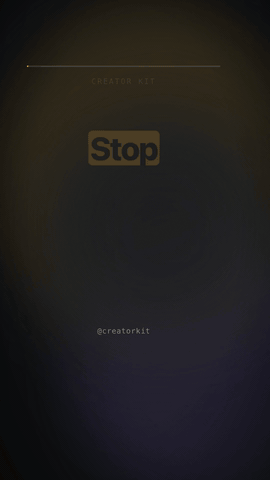
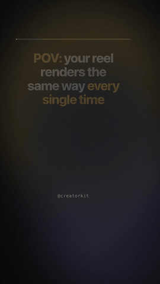
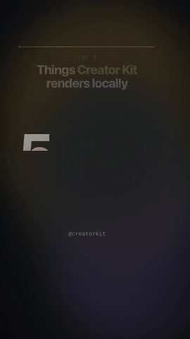
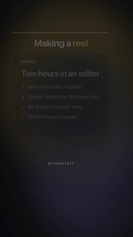
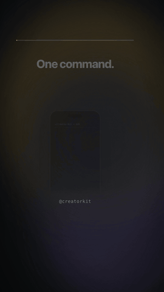
<br/><sub><b>hook</b> · <b>POV</b> · <b>top-N countdown</b> · <b>before / after</b> · <b>phone punch-in</b> — plus quote, stat reveal and carousel</sub>
</div>

Eight short-form formats people actually post, made calm and premium instead of loud. 9:16, 1:1, 4:5 or 16:9.
Captions stay out of the TikTok / Reels / Shorts button areas (`--safe-zones` draws them). Word-by-word karaoke captions can sync to your narration.

<sub><code>python3 creator.py reel --spec examples/reel/countdown.json --platform tiktok --output my-reel --gif</code></sub>

---

## 🔥 Dashboards and data, recorded frame-exact

### Every frame below is real output

> Each clip was rendered straight from the files in [`examples/`](examples/) with one `creator.py` command. No hand-editing.

<table>
<tr>
<td width="50%" valign="top">

### 🛰️ Mission Control cockpit
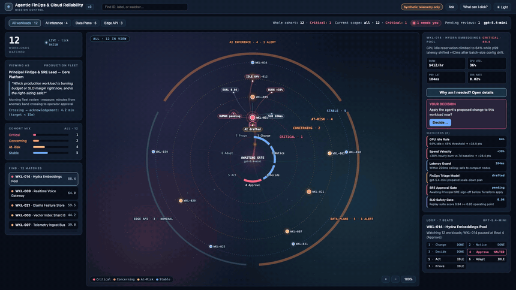

Orbital fleet view, a 7-beat agent loop, an approval gate and live detail cards — from one typed JSON file.

<sub><code>python3 creator.py mission-control render --input examples/mission-control/finops-governance.mission.json --output mc.html --video mc.mp4</code></sub>

</td>
<td width="50%" valign="top">

### 🌌 Prompt-Crawler galaxy
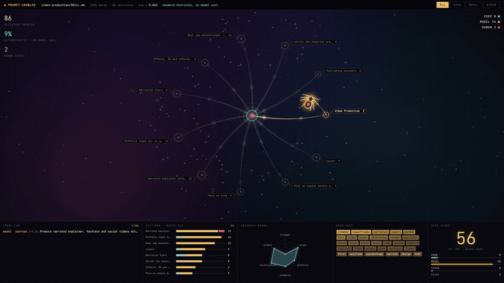

Point it at any prompt or `SKILL.md`. A spider crawls every instruction and sorts it into **code / model / human**, then scores the spec.

<sub><code>python3 creator.py crawl --input skills/video-production/SKILL.md --output crawl --video --speed 9</code></sub>

</td>
</tr>
<tr>
<td width="50%" valign="top">

### 🚦 Pipeline Control
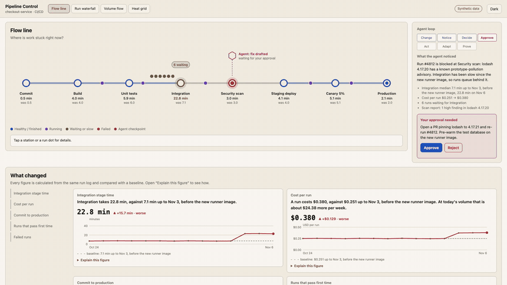

Turns a CI run log into a flow line, "what changed" cards with baselines, and an agent approval card.

<sub><code>python3 creator.py pipeline-control render --input examples/pipeline-control/checkout-service.pipeline.json --output pc.html --video pc.mp4</code></sub>

</td>
<td width="50%" valign="top">

### 📊 Evidence data stories
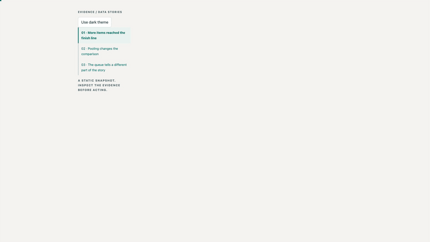

Reading pages where every number points back to its source. Recorded as a guided tour: lines draw, numbers count up to the real value.

<sub><code>python3 creator.py data-story render --input examples/data-story/synthetic-workshop.json --output story.html --video story.mp4</code></sub>

</td>
</tr>
</table>

---

## 🧰 The superpowers

| | Power | One-liner |
|---|---|---|
| 🎙️ | **Five voice engines** | Kokoro, Qwen3, Chatterbox, F5 voice clone, Azure Speech → `narration.wav` + a synced `timeline.json` |
| ✨ | **GSAP motion** | Code-authored title cards and motion graphics you can seek frame by frame |
| 🏛️ | **Architecture diagrams** | Interactive Archify diagrams with an optional guided video tour |
| 🎥 | **Record anything** | `creator.py showcase` turns any animated web page (D3, canvas, three.js) into a frame-exact MP4 |
| 🧱 | **Hero wall** | Your past work as drifting columns with hover-pause and lightbox |
| 🎨 | **Brand styles + design QA** | Brand palettes, plus a browser gate for contrast, overflow and "AI-look" tells |
| ✂️ | **Browser Studio** | Cut, trim, speed, fades, music ducking and captions — non-destructive |
| 👉 | **Walkthroughs** | Arrows, spotlight, zoom, cursor and synced captions over screenshots, narrated |
| 📱 | **Social reels** | Hook, POV, countdown, before/after, phone punch-in, quote, stat, carousel |
| 🔒 | **Safe by default** | Nothing leaves your machine unless you pass `--allow-cloud` |

<details>
<summary><b>🤖 Talk to it like this</b></summary>

> *"Read AGENTS.md and bootstrap this repo."*
>
> *"Make a 60-second narrated explainer of how our checkout pipeline works, dark theme, Kokoro voice."*
>
> *"Crawl my SKILL.md and give me the galaxy video for LinkedIn."*
>
> *"Turn this run log into a Pipeline Control page and record it."*

</details>

---

## 🤖 Using an AI agent? Paste this

**1. Install** (Claude Code, Hermes, GitHub Copilot CLI, Codex):

```text
Clone https://github.com/idanshimon/creator-kit into ~/projects/creator-kit, read AGENTS.md fully,
and bootstrap it. Ask me before installing missing prerequisites. Prove it works with
scripts/smoke.sh and show me the MP4 path. Then install the kit's skills for the agent you are
(AGENTS.md section 3) so you can use them in future sessions. Don't ask me for API keys unless
I want Azure voices.
```

**2. Use it.** Start with "Use Creator Kit to…" and say what you want. The agent picks the tool:

```text
Use Creator Kit to make a 60-second narrated walkthrough of <my app URL> with arrows and captions. Export MP4 and GIF.
Use Creator Kit to turn this repo's architecture into an interactive diagram with a short video tour.
Use Creator Kit to make a data story from <data.csv> with source-backed charts and a 45-second video.
Use Creator Kit to make a 9:16 reel from this blog post, 30 seconds, with captions.
Open the Creator Kit studio and help me trim my last video, add music and fade in/out.
```

## ⚡ Quick start

```bash
git clone <this repo> creator-kit && cd creator-kit
scripts/bootstrap.sh        # installs pinned tools; safe to re-run
scripts/smoke.sh            # checks every renderer, then renders a narrated MP4
python3 creator.py studio   # browser editor at http://127.0.0.1:4318
```

Using an agent? Point it at [AGENTS.md](AGENTS.md) and say *"read AGENTS.md and
bootstrap this repo"*. It contains the full setup, the rules and the workflows.

Prerequisites: Python 3.10+, Node 18+, npm, Git, FFmpeg/ffprobe, Bun (for HyperFrames)
and Google Chrome (for recording HTML to MP4). `scripts/bootstrap.sh` checks all of them
and tells you what to install. `--minimal` installs only the editor and CLI.

## 🗺️ What you can make

| Goal | Tool | Start here |
|---|---|---|
| Narrated explainer / product walkthrough video | HyperFrames + `creator.py narrate` | [skills/video-production](skills/video-production/SKILL.md) |
| Narration with many voices, synced timeline | `creator.py narrate` (Kokoro, Qwen3, Chatterbox, F5, Azure Speech) | [docs/VOICES.md](docs/VOICES.md) |
| Animated title cards and motion graphics | `creator.py motion` (GSAP) + `creator.py showcase` | [docs/GSAP.md](docs/GSAP.md), [docs/SHOWCASE.md](docs/SHOWCASE.md) |
| Interactive architecture diagram, optional video tour | `creator.py diagram` (Archify) | [docs/DIAGRAMS.md](docs/DIAGRAMS.md) |
| Data story with source-backed charts | `creator.py data-story` | [docs/DATA-STORIES.md](docs/DATA-STORIES.md) |
| Operator dashboards (cockpit, pipeline flow) | `creator.py mission-control`, `pipeline-control` | [docs/MISSION-CONTROL.md](docs/MISSION-CONTROL.md), [docs/PIPELINE-CONTROL.md](docs/PIPELINE-CONTROL.md) |
| Hero wall of past work | `creator.py wall` | [docs/WALL.md](docs/WALL.md) |
| Brand palettes + automatic design QA | `creator.py style`, `design-check` | [docs/STYLES.md](docs/STYLES.md) |
| Cut, trim, speed, fades, music ducking, captions | Browser Studio or `creator.py edit` | [docs/STUDIO.md](docs/STUDIO.md), [MODELS-AND-EDITING.md](MODELS-AND-EDITING.md) |
| Record any web page to frame-exact MP4 | `creator.py showcase` | [docs/SHOWCASE.md](docs/SHOWCASE.md) |
| Narrated walkthrough with arrows and captions | `creator.py walkthrough` | [docs/WALKTHROUGH.md](docs/WALKTHROUGH.md) |
| TikTok / Reels / Shorts / LinkedIn video | `creator.py reel` | [docs/REEL.md](docs/REEL.md) |

Run `python3 creator.py --help` for the full command list.

## 🔧 How it fits together

```
your request ──► agent reads AGENTS.md + skills/
                     │
     script ──► creator.py narrate ──► narration.wav + timeline.json
                     │
     scenes ──► HyperFrames compositions / GSAP motion / Archify diagram
                     │
                     ▼
            render (HyperFrames or creator.py showcase) ──► MP4
                     │
                     ▼
     verify: ffprobe + sampled frames + listen ──► productions/<name>/
```

First-party code lives in `creator.py`, `creator_tools/` and `studio-ui/`. Three upstream
open-source projects are installed at pinned revisions by the bootstrap (they are not
copied into this repo): [HyperFrames](https://github.com/heygen-com/hyperframes),
[OpenMontage](https://github.com/calesthio/OpenMontage) and
[Archify](https://github.com/tt-a1i/archify). See [NOTICE.md](NOTICE.md).

## 📁 Repository map

| Path | What it is |
|---|---|
| `AGENTS.md` | Instructions for coding agents: bootstrap, workflows, rules |
| `skills/` | Agent skills (plain Markdown, work with any agent) |
| `creator.py`, `creator_tools/` | The CLI (Python standard library only) |
| `studio-ui/` | Browser editor (React) and browser verification scripts |
| `scripts/` | `bootstrap.sh`, `smoke.sh` |
| `docs/` | One page per feature; [docs/INDEX.md](docs/INDEX.md) lists them |
| `examples/` | Synthetic input files for each renderer |
| `templates/` | Reusable starting points (GSAP motion) |
| `integrations/` | Pinned locks, licenses, brand palettes, voice-model registry |
| `openspec/` | Capability specifications |
| `tests/` | Unit tests (`python3 -m unittest discover -s tests`) |
| `productions/` | Your work. Git-ignored; back it up yourself |

## 🛡️ Safety defaults

- Nothing is uploaded unless you pass `--allow-cloud` on that command.
- Credentials live in `.env` (git-ignored); see [.env.example](.env.example).
- Commands refuse to overwrite existing outputs; pick a new path.
- The Studio listens on 127.0.0.1. `--host` with a private LAN address works but has
  **no login and no TLS**; never expose it to the internet.

## 📜 License

First-party code: [MIT](LICENSE). Upstream tools and vendored assets keep their own
licenses (AGPL-3.0, Apache-2.0, MIT, GSAP Standard License); see [NOTICE.md](NOTICE.md).


<div align="center">


</div>
