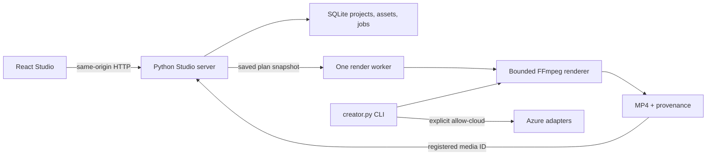

# Architecture

## First-party execution



The UI is an esbuild static bundle served by Python, not a separate Node runtime.
The first-party backend uses Python standard library plus external FFmpeg/ffprobe
and, for optional cloud calls, Azure CLI. No cloud resources are provisioned.

## UI versus wire timeline

The browser uses clip `{id, asset_id, in, out, speed, volume, mute}` objects and
optional named presets for editing ergonomics. `studio-ui/src/lib/wire.ts` converts
these to the **version-1 renderer contract**:

```json
{
  "version": 1,
  "width": 1280,
  "height": 720,
  "fit": "contain",
  "mute": false,
  "volume": 1,
  "fade_in": 0,
  "fade_out": 0,
  "clips": [{"path": "/absolute/registered/source.mp4", "start": 0, "end": 2, "speed": 1, "volume": 1, "mute": false}]
}
```

The server does not accept browser clip IDs, preset names or arbitrary source paths.
The Studio verifies every path against imported assets. The CLI accepts trusted local
sources explicitly provided in the plan. Neither accepts model-generated shell code.

## Persistence and jobs

`Store` keeps project versions, revision-chain cursors, assets and jobs in SQLite.
Mutations include `expected_revision`; stale saves/undo/redo/render requests conflict.
Undo/redo move through saved revisions and increment the current revision counter;
unsaved browser edits have no persistent history.

Imports are copied under workspace `media/`. Exports receive fresh IDs under
`exports/`. One worker processes at most three queued/running jobs. The queue is
not a durable resumable task engine: restart marks interrupted jobs failed.
Assets are served through opaque media IDs with Range support.

## Optional cloud layer

`models.py` inventories Cognitive Services deployments and adapts chat/planning.
`assets.py` supports GPT Image and Whisper SRT. Planning sends filenames, technical
metadata and instructions, not scene frames or transcripts. Tokens remain in memory.
Discovery classifications such as video/embedding/realtime do not create adapters.

## Separate upstream production stack

`OpenMontage/` and `hyperframes/` are ignored, clean upstream checkouts whose known
installed revisions are in [upstream-lock.json](../upstream-lock.json). They support
richer production paths outside the first-party edit engine. Their licenses remain
AGPL-3.0 and Apache-2.0 respectively; this umbrella does not relicense them.

See [Studio trust boundaries](STUDIO.md).
